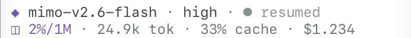

# Steak Pi Companion UI

## Design contract

Steak Pi is a native Pi companion for UltraTerm, not a replacement TUI. It
owns three bounded surfaces exposed by Pi's extension API:

1. a single-line, responsive identity and command header;
2. Steak Pi's adaptive status band and prompt gutter around Pi's native editor,
   including live lifecycle state and context pressure;
3. a conditional extension-status row only when another extension publishes one.

The composer extends Pi's `CustomEditor`; Pi still owns text editing, IME,
autocomplete, history, mouse positioning, paste handling, submission, and all
application keybindings. Pi also continues to own the transcript, Markdown,
tool cards, selectors, scrolling, compaction notices, and session restore. This
preserves upstream behavior while giving Steak Pi a purpose-built entry surface.

Long pastes remain collapsed visually, but editor snapshots expose their full
text. Restoring queued messages, opening dialogs or replacing the editor keeps
the pasted content together with the text typed before and after it. The first
native-to-Steak editor swap also preserves content pasted during startup.

## Visual hierarchy

```text
🥩 STEAK PI                             / commands · /model · /resume

[Pi's native transcript and tool rendering]

◆ mimo-v2.6-flash · high · ● responding ━━━━━━──────────── ◫ 18%/131k · 11.9k tok · 80% cache · $0.018
╰─ Message
[extension status appears here only when present]
```

The composer band communicates, in order:

- active model name, plus thinking level when space permits, never a provider label;
- current lifecycle state;
- context percentage/window, token volume, cache efficiency and session cost;
- a context meter that fills the free space between identity and stats, with a
  pressure-colored thick fill and a dim thin remainder; stats stay flush right.

No baseline footer is rendered. This avoids duplicating the composer status
band; a compact row appears only when another extension publishes status.

Statuses published by other Pi extensions remain visible on a conditional
row, matching the built-in footer contract.

The band uses one line when all values fit, otherwise two lines: identity on the
first, the meter and stats on the second. At
ordinary split-pane widths (40–64 columns), model, thinking level, lifecycle,
context percentage/window, tokens, meaningful cache percentage and cost remain
visible. The meter never takes space from data. Metadata uses the readable muted
text role rather than the faint decorative role.

At very small widths, compact units and up to three lines preserve as much as
possible. Individual numbers are never sliced; an indivisible value that cannot
fit is omitted. Long model names and status details truncate by grapheme. Zero
usage is shown as zero; an unavailable cache ratio is not invented.

Native terminal captures with example data, cropped to the status band:





## State model

| Event | Footer state |
| --- | --- |
| New/startup session | `ready` |
| Resumed session | `resumed` |
| Agent/provider reasoning | `thinking` |
| Text delta | `responding` |
| One tool running | `tool <name>` |
| Parallel tools running | `tools <count>` |
| Extension prompt open | `waiting` |
| Compaction in progress | `compacting` |
| Agent fully settled | `complete` |
| Provider/tool/compaction error | `error` |
| Abort/cancel | `stopped` |

State and meter changes are event-driven from usage Pi already persists. Meter
rendering is a bounded string operation on existing redraws. There are no idle
timers, polling loops, subprocesses, network calls, provider hooks, custom
animation timers, or extra dependencies.

## UltraTerm UI Mode controls

The bundled `ultraterm-ui` bridge exposes the current Pi model scope and saved-session controls to a compatible UltraTerm UI Mode. Its published catalog is curated by the selected harness manifest (`~/.config/ultraterm/harnesses/{harness}.json`, or the app-bundled manifest): it lists exactly the manifest's authenticated, policy-valid native routes, matching native `/model` and the sidebar profile list, and a profile add, rename or removal republishes it on the bounded offline reload without a restart. Model-only selection changes an idle session without sending a prompt. Confirmation comes from the runtime; stale requests fail without discarding the draft. Older bridges retain a next-message override rather than claiming an immediate change.

In UltraTerm UI Mode, `/session` opens the saved-session picker, as does `/resume`. Native Pi's `/session` command still shows session statistics. The picker supports filtering and preview; its search input has no focus ring or glow.

Selecting a model does not authorize paid inference. Explicit paid routes still require the approved launch flag and matching allowlisted provider, model and endpoint. Default workers retain subscription-first routing.

## Theme neutrality

The companion UI contains no RGB, hex, 256-color, dark/light, or UltraTerm
theme mapping. It asks the currently active Pi theme for semantic colors only:
`accent`, `text`, `muted`, `dim`, `success`, `warning`, and `error`.

The three historical Steak themes remain available as optional choices, but
the companion UI neither selects nor requires them. Stock `dark`, stock
`light`, user themes, and future Pi themes all use the same renderer.

## Deterministic simulator

`src/tui/simulator.ts` is a pure headless contract simulator for the
companion-owned hierarchy around representative native transcript/editor
content. It covers startup, prompt, thinking, streaming, tool execution,
errors, completion, compaction, resume, history, scrolling, interruption, and
resize.

Run it without a model, network, or real session:

```sh
npm run ui:simulate -- --scenario tool --width 80 --height 24
npm run ui:simulate -- --scenario complete --width 40 --height 14 --plain
npm run test:tui
```

The simulator is intentionally not a fork or pixel clone of Pi's renderer.
The isolated native smoke test runs the pinned Pi host (currently 1.0.4) on a
private tmux socket with private config/session stores. It covers local submit,
Up/Down history, selector confirmation, real session resume, stock dark/light
themes, ANSI integrity, and 40/48/59/64/80/120/192-column redraws without touching UltraTerm's
tmux sessions. A local scripted provider also checks an exact mixed-paste
message after queuing and interrupting a response; it makes no network request.
A separate delayed-startup test pastes into the initial native editor before
Steak Pi installs its companion, then checks the exact submitted content.
Final visual acceptance still runs against the installed Pi TUI inside UltraTerm.

## Acceptance gates

- Every rendered line is within 20, 24, 32, 40, 80, 120, and 192 columns.
- ANSI styling never changes measured layout width.
- Astra, Luna, and MiMo model labels omit provider names and routing prefixes.
- Truncation never splits an emoji/grapheme.
- Session resume never clears transcript state.
- Editor submit/history/escape and resize remain deterministic in simulation.
- Native submit, Up/Down history, selector confirmation, and resume pass in an
  isolated pinned-Pi PTY smoke test.
- Long pasted content and typed text reach the provider intact after queue
  restoration and the first startup editor swap; native compact paste rendering
  and undo remain intact.
- Print/JSON/RPC modes do not install TUI components.
- Production UI code uses only semantic theme functions.
- The optional meter changes fill at 0%, mid-range, warning and error pressure
  without polling or hiding useful metrics.
- Adaptive band height preserves native content and autocomplete mouse positions.
- Full package tests and TypeScript checks pass before live verification.
- Live UltraTerm checks inspect dark and light themes at desktop widths (1440px
  and 1920px), including stacked panes, without replacing a live tmux pane.
